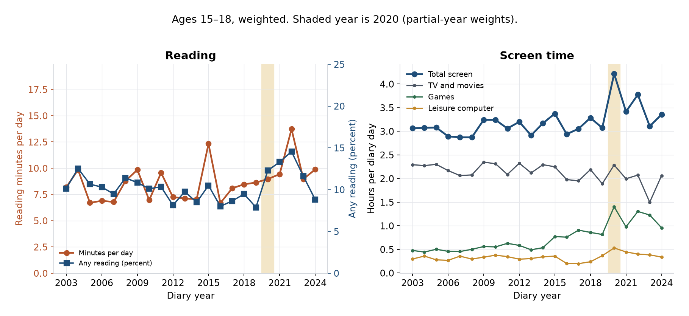
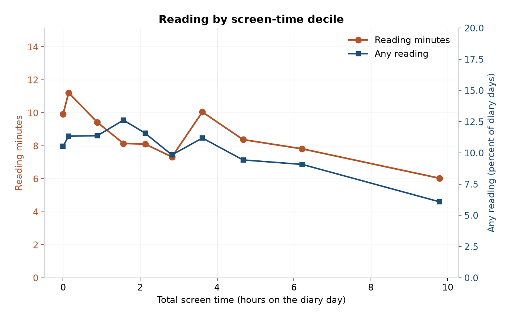
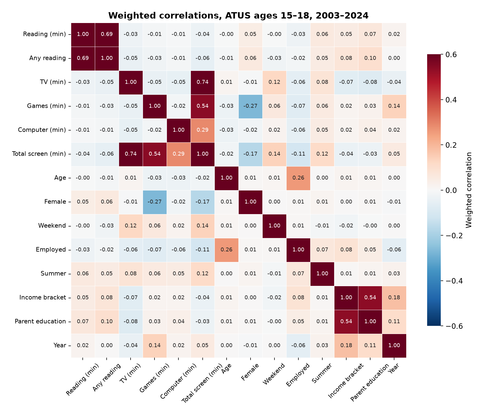
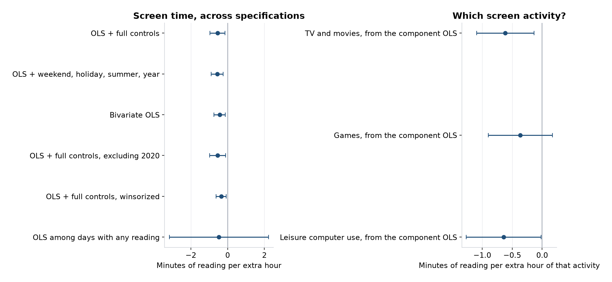

# Screen time and reading among 15–18 year olds

Does screen time explain reading for personal interest among teenagers in the American Time Use Survey?

**It has a small negative association, and it explains almost none of the variation in a diary day.** In the 2003–2024 ATUS, 12,167 respondents aged 15–18 average **8.6 minutes** of reading for personal interest and **3.19 hours** of screen time (TV and movies, games, and leisure computer use). Any of that reading shows up on **10.3%** of diary days. The weighted correlation between total screen minutes and reading minutes is **−0.035**.

An extra hour of screen time is associated with **0.54 fewer minutes of reading** (95% CI **−0.95 to −0.14**) in a weighted regression with age, sex, year, diary-day, school, work, metro, race, Hispanic origin, family income, and parent education. The weighted **R² is 0.022**. Screen time’s partial R² is **0.0018**: about 0.2% of the variation left after the controls. Moving from the 10th percentile of screen time (0 hours) to the 90th (7.3 hours) lines up with about **3.9 fewer minutes** of reading.

The same pattern shows up as a slightly lower chance of reading at all: **0.57 percentage points** per extra screen hour (95% CI −0.85 to −0.29), from a 10.3% base. On days that already include some reading, the screen coefficient is indistinguishable from zero. TV, games, and leisure computer use have similar, imprecise coefficients (about −0.4 to −0.6 minutes of reading per hour of that activity).



Average reading wanders between about 7 and 14 minutes with no steady decline. Total screen time stays near 3 hours, except in 2020 (partial-year weights), when it rises above 4 hours and reading does not fall. Game time is the component that rises, from about half an hour in the mid-2000s toward about an hour in the early 2020s. Television stays near 2 hours. Later years have only about 200 teen diaries, so single-year spikes are noisy.



Weighted deciles are mostly flat. The top decile, about 9.8 hours of screen time, is the low point: about 6.0 reading minutes and any reading on about 6% of days, against about 10 minutes and 11% of days in the lowest deciles.





The full-model coefficient plot, including controls other than year, is in [`figures/full_model_coefs.png`](figures/full_model_coefs.png). School enrollment and employment are associated with about 5 fewer reading minutes, larger than one extra screen hour, and the model still leaves about 98% of diary-day reading unaccounted for.

A static export of the notebook, with the same figures and tables, is in [`docs/atus_reading_screens.html`](docs/atus_reading_screens.html).

## How to run

```bash
python -m venv .venv
source .venv/bin/activate
pip install -r requirements.txt
pip install -e .
marimo edit notebooks/atus_reading_screens.py
# or, without the editor:
marimo run notebooks/atus_reading_screens.py
```

The notebook loads the committed extract `data/extract/teens_15_18.parquet` (12,167 rows). To re-download the BLS microdata and rebuild it:

```bash
ATUS_REBUILD=1 marimo edit notebooks/atus_reading_screens.py
# or
python -m atus_teen --rebuild
```

`python -m atus_teen` refits the models and rewrites `figures/` and `results/`.

The download uses the official 2003–2024 multi-year zips linked from [datafiles-0324.htm](https://www.bls.gov/tus/data/datafiles-0324.htm):

| File | Official URL |
| --- | --- |
| Activity summary | https://www.bls.gov/tus/datafiles/atussum-0324.zip |
| Respondent | https://www.bls.gov/tus/datafiles/atusresp-0324.zip |
| Roster | https://www.bls.gov/tus/datafiles/atusrost-0324.zip |
| ATUS-CPS | https://www.bls.gov/tus/datafiles/atuscps-0324.zip |

BLS rejects some automated clients with HTTP 403. The script then downloads the Internet Archive capture of that same URL. Cached zips live in `data/raw/` and are gitignored. The published extract was built from files with these SHA-256 digests:

| File | SHA-256 |
| --- | --- |
| atussum-0324.zip | `bf39ac14710ab4850c88e3cfc41c6b527bdfb7828549e0f7ccbe889e1d2922a8` |
| atusresp-0324.zip | `6556af3a6ccb1676bce99a1db35b0813766787a0e739be7e23e0b3c8abe31381` |
| atusrost-0324.zip | `81e0cfd195249b6fb2655abc003990e30b5d854d3a464626fa3d88c0842b81c8` |
| atuscps-0324.zip | `d88b32c1429b8d85bbf2c19773c27660101a504c4e4884c8b09d02d8efc66588` |

## Measures

Minutes are Activity Summary columns. The 2003–2024 files use the harmonized lexicon.

| Code | Column | Role |
| --- | --- | --- |
| 120312 | `t120312` | Outcome: reading for personal interest (print, e-readers, and audiobooks) |
| 120303 | `t120303` | Television and movies, not religious |
| 120304 | `t120304` | Television, religious. Included in the TV total; the teen mean is 0.02 minutes |
| 120307 | `t120307` | Playing games. Includes video and computer games, and also board games, cards, and puzzles |
| 120308 | `t120308` | Computer use for leisure, excluding games. Includes leisure browsing and, in later years, social-media sites. The device is not identified |

Total screen time is 120303 + 120304 + 120307 + 120308. ATUS records a primary activity. Phone use is in this total only when the respondent described leisure computer use, games, or television. Scrolling as a secondary activity is omitted. Calls and in-person socializing have other codes and are left out.

Age is `TEAGE` 15–18. The survey weight is `TUFNWGTP`, except in 2020, when that field is zero and the estimate uses `TU20FWGT` (the pandemic weight, covering the months BLS fielded). Weights are scaled to sum to the sample size. Covariance is an HC1 probability-weight sandwich, the robust weighted-regression variance. It is not the BLS replicate-weight variance. The weighted weekend share is 28.8%, close to 2/7, which is the check that the 2020 weight switch is applied.

Family income is the CPS 16-bracket code, edited `HEFAMINC` when it is populated (2010–2024) and unedited `HUFAMINC` in 2003–2009, collapsed to nominal bands. Parent education is the highest CPS `PEEDUCA` among roster members with `TERRP` 24 (parent of the respondent). CPS items were collected two to five months before the diary.

## Specification

Weighted OLS of reading minutes on screen hours, age, sex, year, weekend, holiday, summer, school enrollment, labor-force status, metro status, Hispanic origin, race group, family-income band, and parent-education band. Screen time enters in hours, so the coefficient is minutes of reading per extra hour. The zero mass is handled with a weighted logit for any reading (reported as an average marginal effect) and an OLS fit on the 1,236 diary days with some reading. A normal Tobit censored at zero does not converge to a stable estimate; the zero share is about 90% and the positive tail is long.

| Specification | Estimate | 95% CI | Fit |
| --- | --- | --- | --- |
| Bivariate OLS, minutes per screen hour | −0.43 | −0.74 to −0.13 | R² 0.001 |
| OLS + weekend, holiday, summer, year | −0.56 | −0.89 to −0.24 | R² 0.008 |
| OLS + full controls | −0.54 | −0.95 to −0.14 | R² 0.022 |
| Full controls, excluding 2020 | −0.54 | −0.97 to −0.11 | R² 0.022 |
| Full controls, outcomes capped at the weighted 99th percentile | −0.35 | −0.62 to −0.07 | R² 0.026 |
| OLS on days with any reading | −0.47 | −3.17 to 2.23 | R² 0.097 |
| Logit, change in the probability of any reading | −0.0057 | −0.0085 to −0.0029 | pseudo-R² 0.049 |
| TV hour, component OLS | −0.61 | −1.10 to −0.13 | |
| Games hour, component OLS | −0.36 | −0.90 to 0.17 | |
| Leisure-computer hour, component OLS | −0.64 | −1.27 to −0.02 | |

## Limits

The design is a cross-section of single diary days. Day-to-day noise dominates a stable habit, which keeps R² near zero even when the controls include school, work, season, and family background. Teens choose both activities, and a long screen spell occupies minutes that cannot also be reading, so the coefficient mixes preference with the length of the day. The activity codes miss much of phone use and fold non-screen games into 120307. Income bands are nominal dollars. Intervals omit the replicate-weight design effect; the partial R² does not. Standard errors here are a guide to sampling variability under the robust weighted regression, and the substantive reading of the result is the size of the coefficient and the R².

## Source

U.S. Bureau of Labor Statistics, American Time Use Survey 2003–2024 multi-year microdata (Activity Summary, Respondent, Roster, and ATUS-CPS), https://www.bls.gov/tus/data/datafiles-0324.htm. Activity definitions follow the 2003–2024 coding lexicon and the variable labels in the BLS read-in programs.
